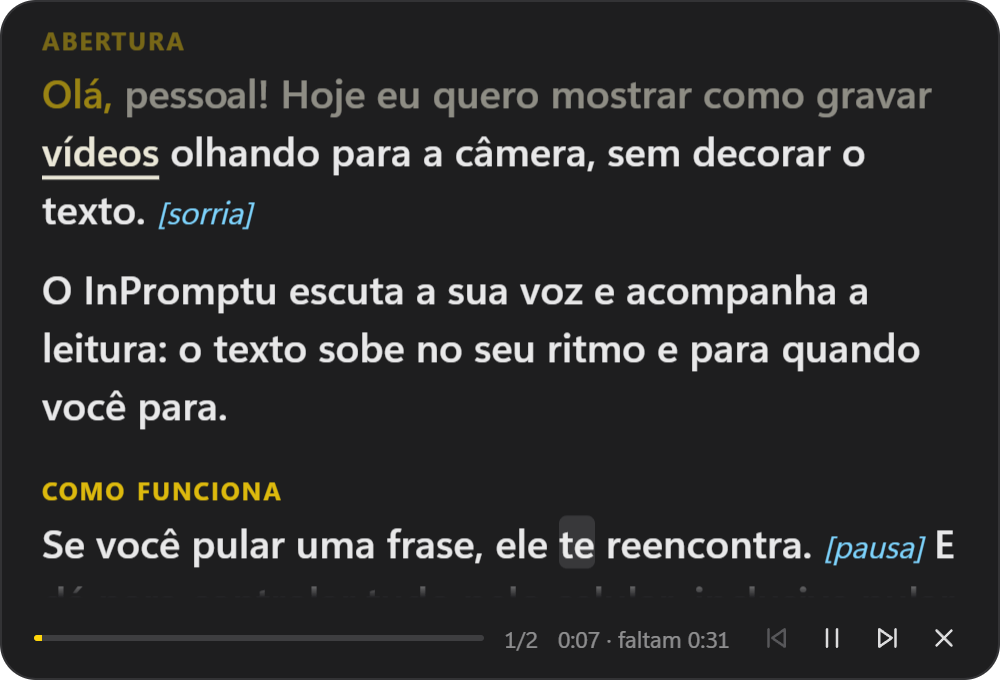
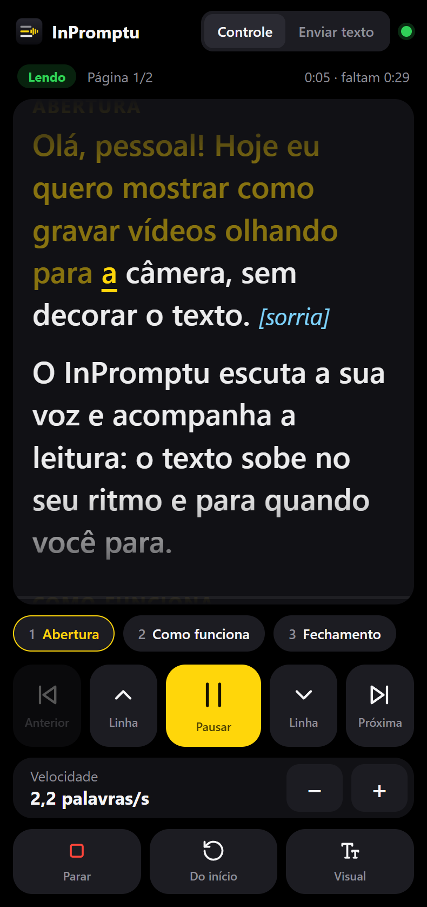

<p align="center"></p>

<h1 align="center">InPromptu</h1>

<p align="center">
  <b>The teleprompter that follows your voice.</b><br>
  Free, offline and open source, for Windows.
</p>

<p align="center">
  <a href="../../releases/latest"><b>Download for Windows</b></a> ·
  <a href="README.md">Português</a>
</p>

<p align="center">
  
  &nbsp;
  
</p>

Paste your script, click **Start** and read while looking at the camera. InPromptu listens to you and highlights
each word as you say it; the text moves at your pace, stops when you stop and finds you again if you skip a
sentence. Everything runs on your computer: no audio ever leaves your machine.

> The interface is in Brazilian Portuguese. Voice tracking currently ships with a Portuguese model; the classic
> and voice-activated modes work with any language.

## Highlights

- **Follows the words, not just the volume.** Recognition is guided by the script itself (Vosk, offline), and
  each recognized phrase is aligned with the text, tolerating skipped, swapped or extra words. A voice activity
  detector (Silero) knows when you are speaking, and the app learns your reading pace.
- **Made for recording.** Talks to OBS Studio: starts recording with the reading, switches scenes and adds
  chapters from markers in your script. When you finish, `.srt` subtitles are ready.
- **Phone remote.** Scan a QR code, no app to install: live text and every control in your hand (same Wi-Fi).
- **A real teleprompter.** Mirrored full screen for beam-splitter glass, a second-screen output, translucency to
  see OBS behind the text, and hidden from screen sharing and recordings.

## Script markers

| Write | What happens |
| --- | --- |
| `[smile]`, `[pause]` | Stage direction, shown in blue and not expected to be read |
| `# Intro` (at the start of a line) | Section: keys `1`–`9` and the phone jump straight to it |
| `[cena: Camera 2]` | Switches OBS to that scene when the reading gets there |
| `[capítulo: Q&A]` | Adds a chapter to the OBS recording |

## Install

Download `InPromptu-Setup-<version>.exe` from [Releases](../../releases/latest) (Windows 10 or 11, 64-bit). Until
the installer is code-signed, Windows may show "Windows protected your PC": click *More info → Run anyway*.

## Privacy

InPromptu does not send any information over the network unless you ask it to: downloading a voice model (from
the [Vosk](https://alphacephei.com/vosk/models) project), turning on the phone remote (local network only,
protected by a secret token in the link) or connecting to OBS. There is no telemetry.

## Code signing policy

Free code signing provided by [SignPath.io](https://about.signpath.io), certificate by
[SignPath Foundation](https://signpath.org). See the [code signing policy](CODE_SIGNING_POLICY.md).

## Development

```bash
npm install    # also copies the voice detector into renderer/vendor
npm start
npm test
npm run dist   # builds the installer into dist/
```

## License and credits

[MIT](LICENSE) © 2026 Luiz Felipe Pitzer Jacob. Third-party components and their licenses are listed in
[THIRD_PARTY_NOTICES.md](THIRD_PARTY_NOTICES.md). Speech recognition by [Vosk](https://alphacephei.com/vosk/)
and [vosk-browser](https://github.com/ccoreilly/vosk-browser); voice activity detection by
[Silero VAD](https://github.com/snakers4/silero-vad) on [ONNX Runtime Web](https://onnxruntime.ai). The idea of a
strip near the camera came from [Textream](https://github.com/f/textream) by Fatih Kadir Akın.
