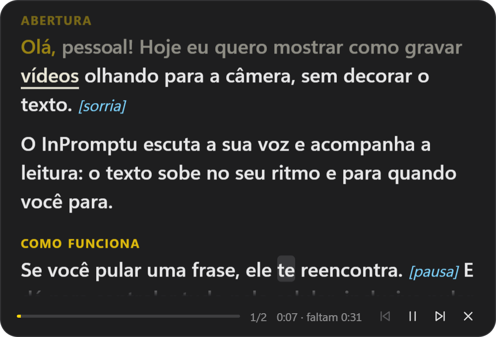
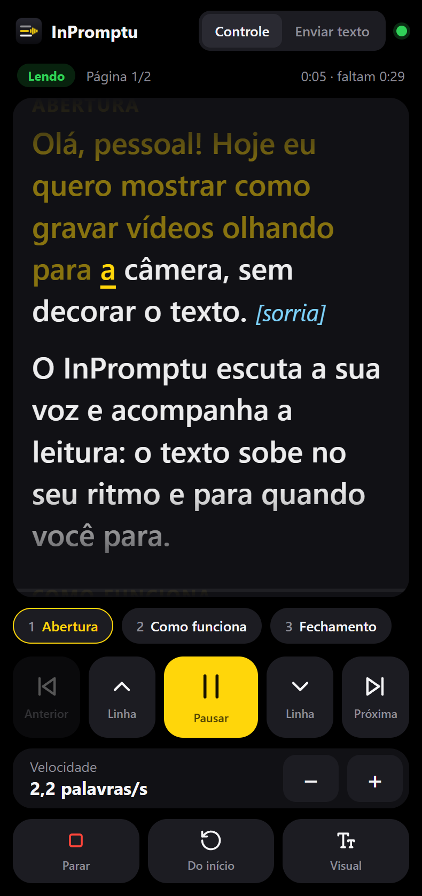
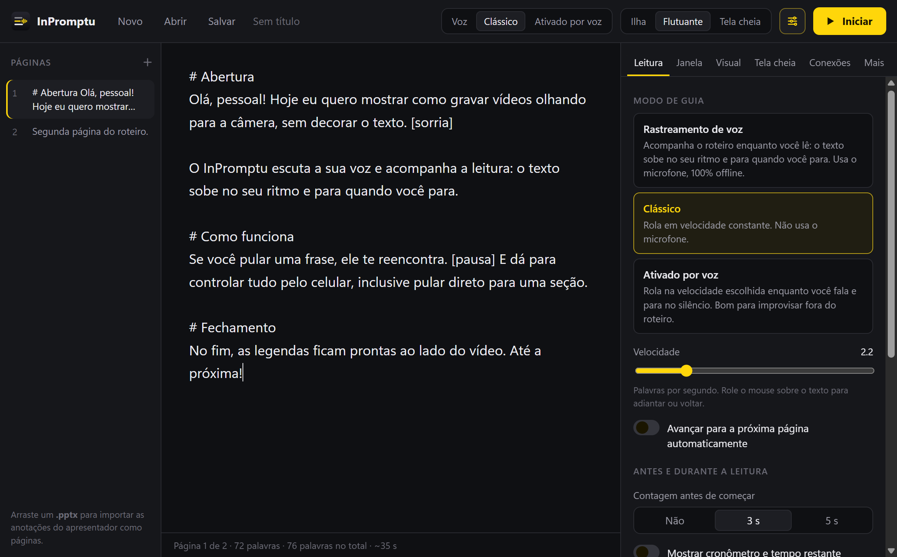

<p align="center"></p>

<h1 align="center">InPromptu</h1>

<p align="center">
  <b>O teleprompter que acompanha a sua voz.</b><br>
  Gratuito, offline e de código aberto, para Windows.
</p>

<p align="center">
  <a href="../../releases/latest"><b>Baixar para Windows</b></a> ·
  <a href="#como-usar">Como usar</a> ·
  <a href="README.en.md">English</a>
</p>

<p align="center">
  
  &nbsp;
  
</p>

Você cola o roteiro, clica em **Iniciar** e lê olhando para a câmera. O InPromptu escuta você e destaca cada
palavra conforme você fala; o texto sobe no seu ritmo, para quando você para e te reencontra se você pular uma
frase. Tudo roda no seu computador: nenhum áudio sai da sua máquina.

## Por que o InPromptu

- **Segue as palavras, não só o volume.** O reconhecimento é guiado pelo próprio roteiro, então acerta nomes e
  termos difíceis, e funciona em português com um modelo leve (~31 MB).
- **Feito para quem grava.** Conversa com o OBS: começa a gravar com a leitura, troca de cena e marca capítulos
  pelo roteiro. No fim, as legendas `.srt` saem prontas.
- **Controle pelo celular.** Abra pelo QR code, sem instalar nada: texto ao vivo e todos os controles na mão.
- **Teleprompter de verdade.** Tela cheia espelhada para vidro, segunda tela para o monitor do teleprompter,
  translucidez para ver o OBS por trás.

## Funções

**Modos de leitura**
- **Rastreamento de voz** — acompanha o roteiro enquanto você lê, 100% offline. Cada frase reconhecida é
  alinhada com o texto, tolerando palavras omitidas, trocadas ou a mais. Um detector de voz (Silero) sabe quando
  você está falando, e o app aprende o seu ritmo de leitura para a próxima vez.
- **Clássico** — rola em velocidade constante (0,5–8 palavras/s), sem microfone.
- **Ativado por voz** — rola enquanto você fala e para no silêncio. Bom para improvisar fora do roteiro.

**Onde o texto aparece**
- **Faixa no topo da tela**, logo abaixo da webcam, para os olhos ficarem perto da câmera.
- **Janela flutuante**, sempre por cima, com efeito vidro.
- **Tela cheia** com espelhamento (para teleprompter com vidro), rotação, fonte, margens, linha de leitura,
  fundo translúcido e a câmera (ou a câmera virtual do OBS) no fundo.
- **Segunda tela**: outra tela cheia, em outro monitor, que acompanha a mesma leitura.
- **Escondido das gravações**: não aparece no Teams, Zoom, Meet, OBS nem em capturas de tela.

**Durante a leitura**
- Contagem 3-2-1, cronômetro com o tempo que falta no seu ritmo e meta de duração.
- Clique numa palavra para continuar dali; role o mouse para ajustar.
- Várias páginas, que avançam sozinhas.

**Celular** (aba *Conexões*) — aponte a câmera do celular para o QR code. O celular mostra o texto ao vivo e tem
pausar, voltar e avançar linhas e páginas, atalhos para as seções, velocidade, microfone e parar. Antes de
começar, mostra o roteiro aberto no computador e deixa escolher o modo. Também dá para escrever e enviar um
roteiro pelo celular. Funciona na mesma rede Wi-Fi.

**OBS Studio** (aba *Conexões*) — grava junto com a leitura e para no fim, troca de cena e marca capítulos.
No OBS: *Ferramentas → Configurações do servidor WebSocket → Ativar servidor WebSocket*; a senha aparece em
*Mostrar informações de conexão*. A senha fica guardada criptografada pelo Windows.

**Arquivos** — `.inpromptu` (várias páginas), `.txt` e `.md` (separe páginas com uma linha `---`) e `.pptx`
(importa as anotações do apresentador, uma página por slide). Arraste o arquivo para a janela.

## Como usar

<p align="center"></p>

1. Instale e abra o InPromptu.
2. Cole o roteiro, escolha o modo e clique em **Iniciar**. Na primeira leitura por voz, o app baixa o modelo do
   idioma (uma vez só).
3. Leia. Para controlar pelo celular, ative em *Conexões* e leia o QR code.

**Marcações no roteiro** (aparecem na tela, mas você não precisa lê-las)

| Escreva | O que acontece |
| --- | --- |
| `[sorria]`, `[pausa]`, `[olhe para a câmera]` | Nota de direção, em azul e itálico |
| `# Abertura` (no começo da linha) | Seção: as teclas `1`–`9` e o celular pulam direto para ela |
| `[cena: Câmera 2]` | Troca o OBS para essa cena quando a leitura passa por ali |
| `[capítulo: Perguntas]` | Marca um capítulo na gravação do OBS |

**Atalhos** (funcionam com qualquer programa em primeiro plano)

| Atalho | Ação |
| --- | --- |
| `Ctrl+Alt+P` | Iniciar / pausar / continuar |
| `Ctrl+Alt+S` | Parar |
| `Ctrl+Alt+M` | Ligar/desligar o microfone |
| `Ctrl+Alt+PageDown` / `PageUp` | Próxima / anterior página |
| `Ctrl+Alt+↑` / `↓` | Voltar / avançar uma linha |
| `Ctrl+Alt+V` | Ler o texto copiado |
| `Ctrl+Alt+T` | Tela cheia: cliques atravessam para o programa de baixo |
| `1` a `9` | Pular para a seção (com o teleprompter em foco) |

Também dá para abrir um texto por link: `inpromptu://read?text=Olá%20mundo`.

## Instalar

Baixe o `InPromptu-Setup-<versão>.exe` em [Releases](../../releases/latest) e abra (Windows 10 ou 11, 64 bits).
Enquanto o instalador não for assinado digitalmente, o Windows pode mostrar "O Windows protegeu o computador":
clique em *Mais informações → Executar assim mesmo*.

Se o microfone não funcionar, confira *Configurações → Privacidade → Microfone → Permitir que aplicativos da
área de trabalho acessem o microfone*.

Quem usava a versão anterior (Roteiro) tem as configurações, o roteiro aberto e o modelo de voz trazidos
automaticamente na primeira abertura.

## Privacidade

O InPromptu não envia nenhuma informação pela rede, a não ser quando você pede: baixar um modelo de voz (do site
do projeto [Vosk](https://alphacephei.com/vosk/models)), ligar o controle pelo celular (só na sua rede local, com
um código secreto no link) ou conectar ao OBS. Não há telemetria nem estatísticas de uso.

## Code signing policy

Free code signing provided by [SignPath.io](https://about.signpath.io), certificate by
[SignPath Foundation](https://signpath.org). Veja a [política de assinatura de código](CODE_SIGNING_POLICY.md)
(papéis da equipe, o que é assinado e privacidade).

## Desenvolvimento

```bash
npm install            # também copia o detector de voz para renderer/vendor
npm start              # abre o app
npm test               # testes do texto e do rastreador, das legendas e da conexão com o OBS
npm run dist           # gera o instalador em dist/
```

Outras ferramentas:

```bash
npm run test:asr -- fala.wav roteiro.txt pt --guiado   # reconhece um WAV de ponta a ponta
npm run obs-mock -- 4455 minhasenha                     # OBS de mentira, mostra cada pedido recebido
node scripts/notices.js                                 # atualiza THIRD_PARTY_NOTICES.md
```

Para medir a rolagem com uma amostra de voz gravada no app (aba *Leitura → Gravar amostra*):

```bash
pwsh -File scripts\medir\medir.ps1 -Amostra "%APPDATA%\InPromptu\amostras\amostra-AAAA-MM-DD_HH-MM-SS.wav"
```

Estrutura:

- `main.js` — janelas, sessão de leitura, atalhos globais, arquivos, OBS, legendas, IPC
- `src/` — configurações, modelos de voz, servidor do celular, `.pptx`, cliente do OBS, legendas
- `renderer/editor.*` — editor de roteiro e configurações
- `renderer/overlay.*` — o teleprompter (e a segunda tela, que só acompanha)
- `renderer/engine.*` — janela oculta com microfone, detector de voz e reconhecimento, em WebAssembly
- `renderer/remote.html` — a página do celular
- `renderer/shared/text.js` — divisão em palavras, marcações e alinhamento da leitura
- `.github/workflows/` — testes a cada mudança e o build das versões (veja [docs/ASSINATURA.md](docs/ASSINATURA.md))

> O NSIS (usado pelo instalador) não aceita caminhos com mais de 260 caracteres. Se a pasta do projeto for
> muito funda, gere o instalador a partir de uma pasta curta (ex.: `C:\dev\inpromptu`).

## Licença e créditos

[MIT](LICENSE) © 2026 Luiz Felipe Pitzer Jacob. Componentes de terceiros e suas licenças em
[THIRD_PARTY_NOTICES.md](THIRD_PARTY_NOTICES.md).

Reconhecimento de voz: [Vosk](https://alphacephei.com/vosk/) e [vosk-browser](https://github.com/ccoreilly/vosk-browser)
(Apache 2.0). Detector de voz: [Silero VAD](https://github.com/snakers4/silero-vad) com
[ONNX Runtime Web](https://onnxruntime.ai) (MIT). Fonte OpenDyslexic (SIL OFL). A ideia da faixa perto da câmera
veio do [Textream](https://github.com/f/textream), de Fatih Kadir Akın.
